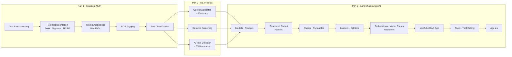
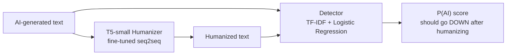
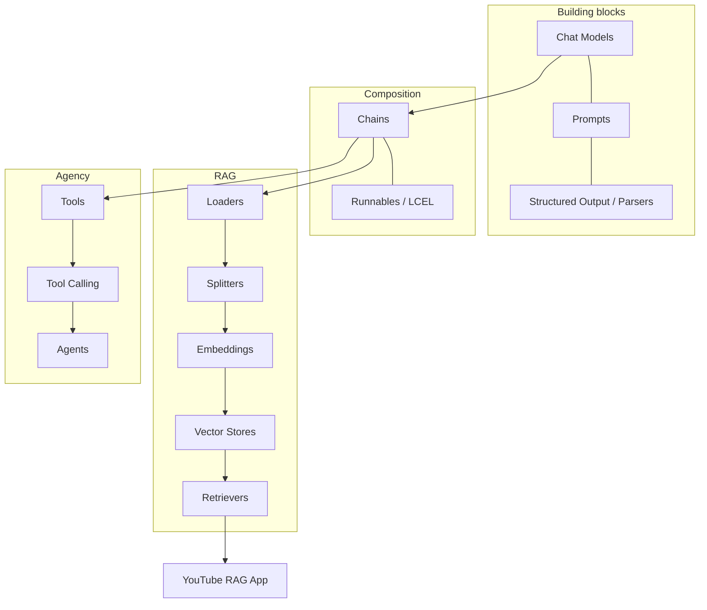
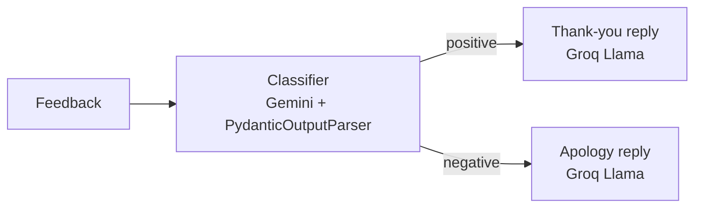
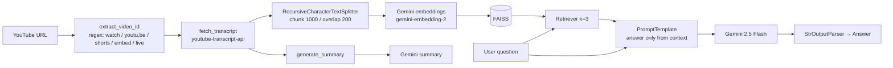
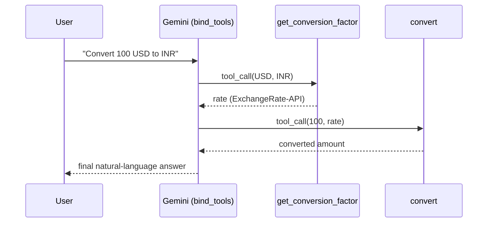

# 🧠 My NLP & Generative AI Learning Journey

> A detailed record of everything I have learned, built and completed in this repository — from cleaning raw text with regex all the way to building tool-calling LLM agents.

**Author:** prottoy94 · **Period:** 31 May 2026 → 5 Nov 2026 · **Repository:** `D:\NLP`

---

## 📊 At a Glance

| Metric | Count |
|---|---|
| Jupyter notebooks | **15** |
| LangChain Python scripts | **66** |
| End-to-end projects | **4** (Quora Duplicates, Resume Screening, AI-Text Humanizer, YouTube RAG) |
| Web apps built | **3** (Quora Flask MVC app, YouTube RAG Flask app, Streamlit paper summarizer) |
| LLM providers used | **4** (Google Gemini, Groq, OpenAI, Hugging Face) |
| Git commits | **38** |
| Best classical model | **97.93 %** accuracy (Resume Screening, KNN + TF-IDF) |

### The journey in one paragraph
I started with the fundamentals of **classical NLP** — cleaning text, turning words into numbers (Bag of Words, TF-IDF), and training my own **Word2Vec** embeddings (including on the *Game of Thrones* books). I used these to build **text classifiers** and then three **real-world ML projects**: duplicate question detection on Quora (served through a Flask web app), resume category screening, and an AI-text detector + T5-based humanizer. I then moved to **Generative AI with LangChain**, working through every layer of the framework — models, prompts, structured output, parsers, chains, runnables, document loaders, text splitters, embeddings, vector stores and retrievers — and combined them into a full **Retrieval-Augmented Generation (RAG) web app for YouTube videos**. Most recently I learned **tools, tool calling and agents**, building a multi-step currency-conversion tool loop and a web-search research agent.

---

## 📑 Table of Contents

1. [Learning Roadmap](#-learning-roadmap)
2. [Tech Stack](#-tech-stack)
3. [Part 1 — Classical NLP Foundations](#part-1--classical-nlp-foundations)
   - [1.1 Text Preprocessing](#11-text-preprocessing)
   - [1.2 Text Representation](#12-text-representation)
   - [1.3 Word Embeddings (Word2Vec)](#13-word-embeddings-word2vec)
   - [1.4 POS Tagging](#14-pos-tagging--dependency-visualisation)
   - [1.5 Text Classification](#15-text-classification)
4. [Part 2 — End-to-End ML Projects](#part-2--end-to-end-ml-projects)
   - [2.1 Quora Duplicate Question Detection](#21-quora-duplicate-question-detection)
   - [2.2 Resume Screening](#22-resume-screening)
   - [2.3 AI-Text Detector & Humanizer](#23-ai-text-detector--humanizer)
5. [Part 3 — Generative AI with LangChain](#part-3--generative-ai-with-langchain)
   - [3.1 Chat Models & LLMs](#31-chat-models--llms)
   - [3.2 Embeddings](#32-embedding-models)
   - [3.3 Prompts](#33-prompts--chat-history)
   - [3.4 Structured Output](#34-structured-output)
   - [3.5 Output Parsers](#35-output-parsers)
   - [3.6 Chains](#36-chains)
   - [3.7 Runnables (LCEL)](#37-runnables-lcel)
   - [3.8 Document Loaders](#38-document-loaders)
   - [3.9 Text Splitters](#39-text-splitters)
   - [3.10 Vector Stores](#310-vector-stores)
   - [3.11 Retrievers](#311-retrievers)
   - [3.12 Capstone — YouTube RAG App](#312-capstone--youtube-rag-web-app)
   - [3.13 Tools](#313-tools)
   - [3.14 Tool Calling](#314-tool-calling)
   - [3.15 Agents](#315-agents)
6. [Skills Checklist](#-skills-checklist)
7. [Project Portfolio](#-project-portfolio)
8. [Timeline](#-timeline)
9. [What's Next](#-whats-next)

---

## 🗺 Learning Roadmap



---

## 🧰 Tech Stack

| Category | Libraries / Services |
|---|---|
| **Core NLP** | NLTK (stopwords, tokenizers, PorterStemmer, WordNetLemmatizer), spaCy + displaCy, TextBlob, `emoji`, `re` |
| **Embeddings** | gensim `Word2Vec`, `simple_preprocess` |
| **Machine Learning** | scikit-learn (CountVectorizer, TfidfVectorizer, GaussianNB, RandomForest, KNN, OneVsOne, LogisticRegression, LabelEncoder, PCA, metrics), XGBoost |
| **String similarity** | fuzzywuzzy (QRatio, partial_ratio, token_sort_ratio, token_set_ratio), difflib |
| **Deep Learning** | PyTorch, Hugging Face Transformers (T5-small, Seq2SeqTrainer), `datasets` |
| **LLM framework** | LangChain (`langchain`, `langchain-core`, `langchain-community`, `langchain-text-splitters`, `langchain-experimental`, `langchain-classic`) |
| **LLMs** | Google **Gemini 2.5 Flash**, Groq **Llama 3.3-70B Versatile** & **Llama 3.1-8B Instant**, OpenAI **GPT-3.5 Turbo**, Hugging Face **flan-t5-large** |
| **Embedding models** | Google `gemini-embedding-001`, `gemini-embedding-2` |
| **Vector databases** | FAISS, Chroma |
| **Data sources** | `youtube-transcript-api`, Wikipedia, DuckDuckGo Search, ExchangeRate-API, PDFs, CSV, web pages |
| **Web / UI** | Flask, Streamlit, HTML/CSS/vanilla JS |
| **Data & Viz** | pandas, NumPy, matplotlib, seaborn, plotly |
| **Dev practices** | `python-dotenv` + `.env` secrets, `.gitignore`, virtual environments, pickling models, Google Colab (GPU) |

---

# Part 1 — Classical NLP Foundations

## 1.1 Text Preprocessing

📓 [`Text preprocessing/movie_sentiment_analysis.ipynb`](Text%20preprocessing/movie_sentiment_analysis.ipynb)
📁 Data: `movie_reviews_sentiment.xlsx`, `chat_slang_dictionary.xlsx`

**Goal:** turn noisy, real-world movie reviews into clean text that a model can learn from.

| Step | What I did | Tool |
|---|---|---|
| Lowercasing | Normalised case so "Movie" and "movie" are the same token | `str.lower()` |
| HTML tag removal | Stripped `<br />` and other tags left in scraped reviews | `re` |
| URL removal | Removed `http://…` / `www…` links | `re` |
| Punctuation removal | Removed `string.punctuation` characters and **timed** the approach on the full dataset | `string`, `time` |
| Slang expansion | Loaded a slang dictionary from Excel and expanded short forms (e.g. *"gr8"* → *"great"*) | `pandas` |
| Spell checking | Corrected misspellings | `TextBlob.correct()` |
| Stopword removal | Removed high-frequency, low-information words | NLTK `stopwords` |
| Emoji handling | Removed emojis or converted them to text (`emoji.demojize`) | `emoji`, `re` |
| Tokenization | Split text into words and sentences | NLTK, spaCy |
| Stemming vs. Lemmatization | Compared crude suffix chopping with dictionary-based lemmas | `PorterStemmer`, `WordNetLemmatizer` |

**Key takeaways**
- Preprocessing order matters (e.g. expand slang *before* removing punctuation).
- Cleaning steps have a real runtime cost on large datasets, so it is worth timing them.
- Stemming is fast but produces non-words (*"studi"*); lemmatization is slower but keeps real words (*"study"*).

---

## 1.2 Text Representation

📓 [`Text represeentation/text_represetation.ipynb`](Text%20represeentation/text_represetation.ipynb)

**Goal:** convert text into numeric vectors.

| Technique | Idea | Implementation |
|---|---|---|
| **Bag of Words** | Count how many times each vocabulary word appears in a document | `CountVectorizer()` |
| **N-grams** | Count word sequences (bi-grams, tri-grams) to keep some word order | `CountVectorizer(ngram_range=(1, 3))` |
| **TF-IDF** | Weight words by frequency in a document × rarity across documents | `TfidfVectorizer()` |

**Key takeaways**
- BoW ignores order and meaning; N-grams recover local order at the cost of a much larger vocabulary.
- TF-IDF down-weights words that appear everywhere ("movie", "film"), which helps classifiers focus on discriminative words.
- All three produce **sparse, high-dimensional** vectors — the motivation for dense embeddings.

---

## 1.3 Word Embeddings (Word2Vec)

📁 [`Word2vec/`](Word2vec/)

### a) Word2Vec on movie reviews
📓 [`Word2vec/word2Vec.ipynb`](Word2vec/word2Vec.ipynb)

A step-by-step notebook (11 sections) covering:
1. Preparing reviews with `simple_preprocess` (lowercase + tokenize + strip punctuation)
2. Training a model and understanding every hyper-parameter:
   - `vector_size` — dimensions per word (100)
   - `window` — context words on each side
   - `min_count` — ignore rare words
   - `sg=1` **skip-gram** vs. `sg=0` **CBOW**
   - `epochs` — training passes
3. Getting a word's vector, finding similar words (`most_similar`)
4. Building an embedding table → saved as `movie_review_word_embeddings.csv`
5. Reducing 100-D vectors to 2-D with **PCA** and plotting them
6. Saving / reloading the model (`movie_review_word2vec.model`)

### b) Word2Vec on *Game of Thrones*
📓 [`Word2vec/got_tranning.ipynb`](Word2vec/got_tranning.ipynb) · 📁 Data: 5 books (`001ssb.txt` … `005ssb.txt`)

- Sentence-tokenized the books with NLTK, tokenized words with gensim.
- Trained a custom model → **17,453-word vocabulary**, **100-dimensional** vectors.
- The model learned real semantic relationships from raw text alone:

```text
model.wv.most_similar("daenerys")
→ stormborn (0.78), targaryen (0.77), unburnt (0.74), princess (0.73),
  myrcella (0.71), viserys (0.71), dorne, elia, queen, rhaegar
```

- Reduced the vectors to 3-D with PCA and visualised them in an interactive **plotly** 3-D scatter plot.

**Key takeaways**
- Embeddings are **dense** and capture meaning: words used in similar contexts get similar vectors.
- Domain-specific training data produces domain-specific knowledge (titles, families, places).

---

## 1.4 POS Tagging & Dependency Visualisation

📓 [`pos_tagging.ipynb`](pos_tagging.ipynb)

- Used **spaCy** pipelines to assign part-of-speech tags (`token.pos_`, `token.tag_`) and dependencies.
- Visualised dependency trees with **displaCy** (`displacy.render(doc, style='dep')`).

---

## 1.5 Text Classification

📁 [`Text Classification/`](Text%20Classification/) · Dataset: `IMDB Dataset.csv` (sample of ~10,000 reviews, balanced: 5,028 positive / 4,972 negative)

📓 [`text_classification.ipynb`](Text%20Classification/text_classification.ipynb) · 📓 [`word_to_vec_text_classification.ipynb`](Text%20Classification/word_to_vec_text_classification.ipynb)

**Pipeline:** clean text → remove stopwords → `LabelEncoder` → `train_test_split` (80/20) → vectorize → train → evaluate (`accuracy_score`, `classification_report`, `confusion_matrix`).

### Results

| Features | Model | Accuracy |
|---|---|---|
| Bag of Words (48,282 features) | Gaussian Naive Bayes | 63.2 % |
| Bag of Words (48,282 features) | Random Forest | 84.4 % |
| Bag of Words (top 5,000 features) | Random Forest | 83.9 % |
| **TF-IDF** | **Random Forest** | **84.9 %** 🏆 |
| Averaged Word2Vec (100-D per review) | Random Forest | 77.7 % |

**Key takeaways**
- Gaussian NB assumes continuous, normally distributed features — a poor fit for sparse word counts (Multinomial NB would suit better).
- Cutting the vocabulary from 48k → 5k features lost only 0.5 % accuracy while being far cheaper.
- **Averaging** word vectors throws away word order and dilutes strong sentiment words, so on this small dataset sparse TF-IDF beat dense Word2Vec features.

---

# Part 2 — End-to-End ML Projects

## 2.1 Quora Duplicate Question Detection

📁 [`Quora Dataset Project/`](Quora%20Dataset%20Project/) · Dataset: `quora_duplicate_questions.tsv` (**404,290** question pairs)

📓 [`duplicate_question_project.ipynb`](Quora%20Dataset%20Project/duplicate_question_project.ipynb) (EDA / baseline) · 📓 [`final_duplicate_project.ipynb`](Quora%20Dataset%20Project/final_duplicate_project.ipynb) (full feature engineering)

**Problem:** given two questions, predict whether they ask the same thing.

### Preprocessing
- Lowercasing, replacing special symbols (`%`, `$`, `@`…) with words, shortening large numbers
- Expanding **contractions** (*"can't"* → *"cannot"*) with a large dictionary
- Stripping HTML with **BeautifulSoup**

### Feature engineering (22 hand-crafted features + BoW)

| Group | Features |
|---|---|
| **Basic** | `len_q1`, `len_q2`, `q1_num_words`, `q2_num_words`, `word_common`, `total_words`, `word_share` |
| **Token features** | `cwc_min/max` (common non-stopwords), `csc_min/max` (common stopwords), `ctc_min/max` (common tokens), `first_word_eq`, `last_word_eq` |
| **Length features** | `len2_q1`, `len2_q2`, `len2_ratio` (from `fetch_length_features`) |
| **Fuzzy features** | `fuzz_ratio`, `fuzz_partial_ratio`, `fuzz_token_sort_ratio`, `fuzz_token_set_ratio` (fuzzywuzzy) |
| **Text** | Bag of Words, `max_features=3000` per question, concatenated |

### Results

| Model | Accuracy |
|---|---|
| **Random Forest** | **80.4 %** 🏆 |
| XGBoost | 79.4 % |

### 🌐 Deployment — Flask MVC web app
📁 [`Quora Dataset Project/webapp/`](Quora%20Dataset%20Project/webapp/)

```text
webapp/
├── app.py                  # Flask entry point
├── controller/routes.py    # HTTP routes (Controller)
├── model/predictor.py      # loads rf_model.pkl + count_vectorizer.pkl, rebuilds all 22 features (Model)
├── templates/index.html    # UI (View)
└── static/js/{model,view,controller}.js   # front-end also split into MVC
```

- The trained model and vectorizer were **pickled** and loaded by `predictor.py`, which re-implements the exact same preprocessing + feature pipeline (`query_point_creator`) so live predictions match training.
- Includes a graceful fallback to `difflib.SequenceMatcher` if `fuzzywuzzy` is not installed.

**What I learned:** feature engineering often beats raw model choice; the training and inference pipelines must be identical; structuring a web app with MVC on both server and client.

---

## 2.2 Resume Screening

📁 [`Resume Screening Project/`](Resume%20Screening%20Project/) · 📓 [`model.ipynb`](Resume%20Screening%20Project/model.ipynb) · Dataset: `UpdatedResumeDataSet.csv` (**962 resumes, 25 job categories**)

**Problem:** automatically classify a resume into a job category (Data Science, HR, Java Developer, …).

**Pipeline**
1. EDA — category distribution with **plotly** (bar + pie subplots)
2. Cleaning — lowercase, remove URLs, e-mails/mentions, hashtags, non-ASCII characters, punctuation and HTML (BeautifulSoup); convert currency symbols to words (`$` → *dollar*, `₹` → *rupee*, …)
3. Testing on a custom, hand-written data-scientist resume
4. Vectorizing with **TF-IDF** (`max_features=3000`) → (962 × 3000) sparse matrix
5. Visualising the class separation with **PCA**
6. Training a **One-vs-One K-Nearest-Neighbours** classifier
7. Building a `pred()` helper for new resumes and **pickling** the model + vectorizer

### Results
| Metric | Value |
|---|---|
| Test samples | 193 |
| Correct predictions | 189 |
| **Accuracy** | **97.93 %** 🏆 |

**What I learned:** multi-class strategies (OvO vs. OvR), TF-IDF + simple distance-based models can be extremely strong on well-separated domain text, and how to package a model for reuse.

---

## 2.3 AI-Text Detector & Humanizer

📁 [`Humanizer Project/`](Humanizer%20Project/) · Dataset: [Defactify Text Dataset](https://huggingface.co/datasets/Rajarshi-Roy-research/Defactify_Text_Dataset) (≈ **73,000** samples, human vs. AI-generated text, cached locally as Arrow files)

| Notebook | Purpose |
|---|---|
| [`humanizer_starter.ipynb`](Humanizer%20Project/humanizer_starter.ipynb) | Setup, loading with `datasets.load_dataset`, EDA (label balance, text-length distributions) |
| [`humanizer_modeling.ipynb`](Humanizer%20Project/humanizer_modeling.ipynb) | Local modelling version |
| [`humanizer_modeling_colab_main.ipynb`](Humanizer%20Project/humanizer_modeling_colab_main.ipynb) | Full pipeline on Google Colab GPU (Drive mounted for persistence) |
| [`humanizer_modeling_simplified_colab.ipynb`](Humanizer%20Project/humanizer_modeling_simplified_colab.ipynb) | Lighter version for quicker experiments |

**Two-model design**



1. **Detector (the "oracle")** — TF-IDF + Logistic Regression on `Label_A` (0 = human, 1 = AI). Evaluated with a classification report, **ROC-AUC**, and a confusion matrix. Wrapped in `detector_score(texts)` → probability of AI.
2. **Humanizer** — **T5-small** fine-tuned with Hugging Face `Seq2SeqTrainer` (`DataCollatorForSeq2Seq`, 3 epochs, lr 3e-4, batch 8, max length 256) on (AI → human) text pairs. Because the dataset isn't row-paired, AI and human texts were matched randomly as a stand-in.
3. **Evaluation** — sample 20 AI texts, humanize them, and compare the detector's score before vs. after.
4. **Saving** — models saved to Google Drive so they survive Colab disconnects.

> ℹ️ The saved notebooks don't contain cell outputs, so final metrics aren't recorded here — the full pipeline is built and runnable.

**What I learned:** fine-tuning a Transformer seq2seq model, tokenization with max lengths, GPU training on Colab, and using one model to evaluate another (adversarial-style evaluation).

---

# Part 3 — Generative AI with LangChain

📁 [`LangChain_Models/`](LangChain_Models/) · 📄 [`requirements.txt`](LangChain_Models/requirements.txt)

All scripts load API keys with `python-dotenv` from a git-ignored `.env` file (`GOOGLE_API_KEY`, `GROQ_API_KEY`, `OPENAI_API_KEY`, `HUGGINGFACEHUB_API_TOKEN`, `EXCHANGE_RATE_API_KEY`).



---

## 3.1 Chat Models & LLMs

📁 [`ChatModels/`](LangChain_Models/ChatModels/) · [`LLMs/`](LangChain_Models/LLMs/)

| File | Provider / Model |
|---|---|
| [`chatmodel_google.py`](LangChain_Models/ChatModels/chatmodel_google.py) | `ChatGoogleGenerativeAI` — **gemini-2.5-flash** |
| [`chatmodel_groq.py`](LangChain_Models/ChatModels/chatmodel_groq.py) | `ChatGroq` — **llama-3.3-70b-versatile** |
| [`chatmodel_openai.py`](LangChain_Models/ChatModels/chatmodel_openai.py) | `ChatOpenAI` — **gpt-3.5-turbo** |
| [`chatmodel_hf_api.py`](LangChain_Models/ChatModels/chatmodel_hf_api.py) | Hugging Face Endpoint — **google/flan-t5-large** |
| [`llm_demo.py`](LangChain_Models/LLMs/llm_demo.py) | Old-style text-completion LLM interface |
| [`find.py`](LangChain_Models/find.py) | Lists all **currently active Groq models** via the Groq SDK |

**Concepts:** LLM vs. Chat Model interfaces, `temperature`, `max_tokens` / `max_output_tokens`, provider-agnostic `.invoke()`, managing API keys safely, and handling deprecated models.

---

## 3.2 Embedding Models

📁 [`Embedded/`](LangChain_Models/Embedded/)

- [`em_model_geni.py`](LangChain_Models/Embedded/em_model_geni.py) — `GoogleGenerativeAIEmbeddings` (`gemini-embedding-001`), `embed_query` vs. `embed_documents`.
- [`document_similarity.py`](LangChain_Models/Embedded/document_similarity.py) — a mini semantic search engine: embed 5 cricketer descriptions, embed the query *"Who is the god of cricket?"*, rank with **cosine similarity** → returns the Sachin Tendulkar document.

```python
scores = cosine_similarity([query_embedding], doc_embeddings)[0]
index, score = sorted(enumerate(scores), key=lambda x: x[1], reverse=True)[0]
```

---

## 3.3 Prompts & Chat History

📁 [`LangChain_promts/`](LangChain_Models/LangChain_promts/)

| File | Concept |
|---|---|
| [`messages.py`](LangChain_Models/LangChain_promts/messages.py) | `SystemMessage`, `HumanMessage`, `AIMessage` |
| [`chatbot.py`](LangChain_Models/LangChain_promts/chatbot.py) | CLI chatbot with a growing **chat history** list (`while True` loop, `exit`/`quit` to stop) |
| [`chat_promt_template.py`](LangChain_Models/LangChain_promts/chat_promt_template.py) | `ChatPromptTemplate` with role-based messages |
| [`message_placeholder.py`](LangChain_Models/LangChain_promts/message_placeholder.py) | `MessagesPlaceholder` — injecting saved history (`chat_history.txt`) into a prompt |
| [`promt_generator.py`](LangChain_Models/LangChain_promts/promt_generator.py) | Building a reusable `PromptTemplate` and **saving** it → [`paper_summary_template.json`](LangChain_Models/paper_summary_template.json) |
| [`prompt_ui.py`](LangChain_Models/LangChain_promts/prompt_ui.py) → [`prompt_ui2.py`](LangChain_Models/LangChain_promts/prompt_ui2.py) → [`prompt_ui3.py`](LangChain_Models/LangChain_promts/prompt_ui3.py) | **Streamlit** research-paper summarizer: pick paper, explanation style and length from dropdowns; template loaded with `load_prompt` |

**Concepts:** static vs. dynamic prompts, why templates beat f-strings (validation, reuse, serialization), how chat models are stateless and history must be passed every turn.

---

## 3.4 Structured Output

📁 [`LangChain_structured_output/`](LangChain_Models/LangChain_structured_output/)

Getting **machine-readable** data from an LLM using `model.with_structured_output(...)`:

| File | Schema style |
|---|---|
| [`typeddict.py`](LangChain_Models/LangChain_structured_output/typeddict.py) | `TypedDict` + `Annotated` descriptions |
| [`pydantic_demo.py`](LangChain_Models/LangChain_structured_output/pydantic_demo.py) | Pydantic basics: types, defaults, `Optional`, `EmailStr`, `Field` constraints, validation |
| [`structured_output_demo_pydantic.py`](LangChain_Models/LangChain_structured_output/structured_output_demo_pydantic.py) | Pydantic `Review` model |
| [`with_json.py`](LangChain_Models/LangChain_structured_output/with_json.py) | Raw **JSON Schema** |

Example — turning a free-text phone review into structured data:

```python
class Review(BaseModel):
    key_themes: list[str]
    summary: str
    sentiment: Literal["positive", "negative"]
    pros: Optional[list[str]] = None
    cons: Optional[list[str]] = None
    reviewer_name: Optional[str] = None

structured_model = model.with_structured_output(Review)
```

**Concepts:** TypedDict (type hints only) vs. Pydantic (runtime validation) vs. JSON Schema (language-agnostic).

---

## 3.5 Output Parsers

📁 [`Output_parsers/`](LangChain_Models/Output_parsers/)

For models that don't support native structured output:

| Parser | File | Use |
|---|---|---|
| `StrOutputParser` | [`stroutputparser.py`](LangChain_Models/Output_parsers/stroutputparser.py), [`strouputparser.py`](LangChain_Models/Output_parsers/strouputparser.py), [`main_stroutput_parser.py`](LangChain_Models/Output_parsers/main_stroutput_parser.py) | Plain text out of a message; chaining a "detailed report → 5-line summary" |
| `JsonOutputParser` | [`json_output_parser.py`](LangChain_Models/Output_parsers/json_output_parser.py), [`json_output_parser_2.py`](LangChain_Models/Output_parsers/json_output_parser_2.py) | Free-form JSON (name, age, city of a fictional person) via `get_format_instructions()` |
| `StructuredOutputParser` | [`structured_output_shcema.py`](LangChain_Models/Output_parsers/structured_output_shcema.py) | JSON following `ResponseSchema`s (4 facts about a topic) |
| `PydanticOutputParser` | [`pydanticoutputparser.py`](LangChain_Models/Output_parsers/pydanticoutputparser.py) | Validated Pydantic objects (with Groq Llama 3.1-8B) |

---

## 3.6 Chains

📁 [`LangChain_chains/`](LangChain_Models/LangChain_chains/)

| Chain | File | What it does |
|---|---|---|
| **Simple** | [`simple_chain.py`](LangChain_Models/LangChain_chains/simple_chain.py) | `prompt \| model \| parser` |
| **Sequential** | [`sequential_chain.py`](LangChain_Models/LangChain_chains/sequential_chain.py) | Detailed report on *"Unemployment in Bangladesh"* → 5-point summary |
| **Parallel** | [`parallel_chain.py`](LangChain_Models/LangChain_chains/parallel_chain.py) | Gemini writes **notes** while Groq Llama writes a **quiz** at the same time → merged into one document |
| **Conditional** | [`conditional_chain.py`](LangChain_Models/LangChain_chains/conditional_chain.py) | Classify feedback sentiment (Pydantic parser) → `RunnableBranch` routes to a positive or negative reply prompt |



**Concepts:** the pipe `|` operator (LCEL), mixing different LLM providers in one chain, visualising chains with `chain.get_graph().print_ascii()`.

---

## 3.7 Runnables (LCEL)

📁 [`LangChain_runnables/`](LangChain_Models/LangChain_runnables/) — all using Groq **llama-3.3-70b-versatile**

| Runnable | File | Example task |
|---|---|---|
| — | [`simple_llm_app.py`](LangChain_Models/LangChain_runnables/simple_llm_app.py) | Blog-title generator — the "before runnables" manual pipeline |
| `RunnableSequence` | [`runnable_sequence.py`](LangChain_Models/LangChain_runnables/runnable_sequence.py) | Joke → explanation of the joke |
| `RunnableParallel` | [`runnable_parallel.py`](LangChain_Models/LangChain_runnables/runnable_parallel.py) | One topic → a tweet **and** a LinkedIn post simultaneously |
| `RunnablePassthrough` | [`runnable_passthrough.py`](LangChain_Models/LangChain_runnables/runnable_passthrough.py) | Return the original joke alongside its explanation |
| `RunnableLambda` | [`runnable_lambda.py`](LangChain_Models/LangChain_runnables/runnable_lambda.py) | Wrap a plain Python function as a chain step (joke → explanation pipeline) |
| `RunnableBranch` | [`runnable_branch.py`](LangChain_Models/LangChain_runnables/runnable_branch.py) | Write a detailed report, then summarize it only when a condition (e.g. length) is met |

**Concept:** every LangChain component implements the same `Runnable` interface (`invoke`, `batch`, `stream`), so anything can be plugged into anything.

---

## 3.8 Document Loaders

📁 [`Document_loaders/`](LangChain_Models/Document_loaders/)

| Loader | File | Source |
|---|---|---|
| `TextLoader` | [`text_loader.py`](LangChain_Models/Document_loaders/text_loader.py) | `cricket.txt` → summarized with Groq |
| `PyPDFLoader` | [`pdf_loader.py`](LangChain_Models/Document_loaders/pdf_loader.py) | `dl-curriculum.pdf` (one `Document` per page) |
| `DirectoryLoader` | [`directory_loader.py`](LangChain_Models/Document_loaders/directory_loader.py) | A folder of large textbooks (`books/*.pdf`) — `load()` vs. `lazy_load()` |
| `WebBaseLoader` | [`webbase_loader.py`](LangChain_Models/Document_loaders/webbase_loader.py) | Scrape a web page, then ask questions about it |
| `CSVLoader` | [`csv_loader.py`](LangChain_Models/Document_loaders/csv_loader.py) | `Social_Network_Ads.csv` (one `Document` per row) |

**Concepts:** the `Document` object (`page_content` + `metadata`), eager vs. lazy loading for big files.

---

## 3.9 Text Splitters

📁 [`Text_splitters/`](LangChain_Models/Text_splitters/)

| Strategy | File | How it splits |
|---|---|---|
| **Length-based** | [`length_based.py`](LangChain_Models/Text_splitters/length_based.py) | `CharacterTextSplitter` — fixed `chunk_size` / `chunk_overlap` |
| **Text-structure-based** | [`text_structure_based.py`](LangChain_Models/Text_splitters/text_structure_based.py) | `RecursiveCharacterTextSplitter` — paragraphs → sentences → words |
| **Document/code-structure-based** | [`markdown.py`](LangChain_Models/Text_splitters/markdown.py) | `RecursiveCharacterTextSplitter.from_language(Language.PYTHON)` — splits on classes/functions |
| **Semantic** | [`semantic.py`](LangChain_Models/Text_splitters/semantic.py) | `SemanticChunker` + Gemini embeddings — splits where the *meaning* changes |

**Concept:** chunk size and overlap trade off context completeness vs. retrieval precision.

---

## 3.10 Vector Stores

📁 [`Vector_store/`](LangChain_Models/Vector_store/) · [`store.py`](LangChain_Models/Vector_store/store.py) · [`store.ipynb`](LangChain_Models/Vector_store/store.ipynb)

- Created `Document`s about IPL players with **metadata** (team).
- Stored them in **Chroma** with `persist_directory="vectorstore_data"` (persists to disk).
- Operations: `add_documents`, `similarity_search`, `similarity_search_with_score`, and **metadata filtering** (e.g. only *Mumbai Indians* players) for questions like *"Who is the best captain in IPL history?"*.
- Also used **FAISS** (in-memory, very fast) in the retriever and RAG work.

---

## 3.11 Retrievers

📁 [`Retrivers/`](LangChain_Models/Retrivers/)

| Retriever | File | Idea |
|---|---|---|
| `WikipediaRetriever` | [`retriver.py`](LangChain_Models/Retrivers/retriver.py) | Fetch Wikipedia articles live (`top_k_results=2`) |
| Vector-store retriever | [`vector.py`](LangChain_Models/Retrivers/vector.py) | `vectorstore.as_retriever(search_kwargs={"k": …})` |
| **MMR** | [`mmr.py`](LangChain_Models/Retrivers/mmr.py) | *Maximal Marginal Relevance* — relevant **and** diverse results (`search_type="mmr"`, `k=2`, `lambda_mult=0.7`) |
| **Multi-Query** | [`multi_query.py`](LangChain_Models/Retrivers/multi_query.py) | The LLM rewrites an ambiguous query (*"How to balance energy and resources?"*) into several versions and merges the results — compared side by side with plain similarity search |
| **Contextual Compression** | [`contextual_compress.py`](LangChain_Models/Retrivers/contextual_compress.py) | `LLMChainExtractor` keeps only the sentences in each retrieved chunk that are relevant to the query |

**Concept:** retrieval quality is the main lever for RAG quality; different retrievers fix different failure modes (redundancy, ambiguous queries, noisy chunks).

---

## 3.12 Capstone — YouTube RAG Web App

📁 [`LangChain_Models/yt_rag/`](LangChain_Models/yt_rag/)

**Chat with any YouTube video:** paste a link → the app fetches the transcript, generates a summary, and answers questions grounded *only* in what the video says.

| File | Role |
|---|---|
| [`main.py`](LangChain_Models/yt_rag/main.py) | First working script version of the pipeline |
| [`using_chain.py`](LangChain_Models/yt_rag/using_chain.py) | Same pipeline rewritten as an LCEL chain |
| [`rag_pipeline.py`](LangChain_Models/yt_rag/rag_pipeline.py) | Production version split into 5 reusable functions |
| [`app.py`](LangChain_Models/yt_rag/app.py) | Flask server + JSON API |
| `templates/index.html`, `static/css/style.css`, `static/js/app.js` | Front-end |

### Architecture



```python
rag_chain = (
    RunnableParallel({
        "context": retriever | RunnableLambda(format_docs),
        "question": RunnablePassthrough(),
    })
    | prompt | llm | StrOutputParser()
)
```

### Engineering highlights
- **REST API:** `POST /api/load-video`, `POST /api/summarize`, `POST /api/chat`
- **Per-user sessions:** each browser gets a random session id; its transcript, retriever and chain live in an in-memory dict guarded by a `threading.Lock`, capped at `MAX_SESSIONS = 20`
- **Robust URL parsing:** a single regex handles `watch?v=`, `youtu.be/`, `/shorts/`, `/embed/`, `/live/`, mobile and music sub-domains, and extra query params
- **Friendly error handling:** a custom `RAGError` maps transcript errors (`TranscriptsDisabled`, `NoTranscriptFound`, `VideoUnavailable`, `RequestBlocked`, …) to clear user messages
- **Grounded answers:** the prompt (temperature 0) says *answer ONLY from the transcript* and to reply *"I can't determine that from the available transcript context"* otherwise, which reduces hallucination

---

## 3.13 Tools

📁 [`Tools/`](LangChain_Models/Tools/)

| File | Concept |
|---|---|
| [`basicTool.py`](LangChain_Models/Tools/basicTool.py) | Built-in tools: `DuckDuckGoSearchRun` (web search) and `ShellTool` (run shell commands) |
| [`customTool.py`](LangChain_Models/Tools/customTool.py) | Custom tool with the `@tool` decorator — inspecting `name`, `description`, `args` |
| [`str_pyd.py`](LangChain_Models/Tools/str_pyd.py) | `StructuredTool.from_function` with a Pydantic `args_schema` |
| [`baseTool.py`](LangChain_Models/Tools/baseTool.py) | Subclassing `BaseTool` and implementing `_run` (full control) |
| [`toolkit.py`](LangChain_Models/Tools/toolkit.py) | Grouping related tools (`add`, `multiply`) into a `MathToolkit` |

**Concept:** a tool = a function + a **name** + a **description** + an **argument schema**. The LLM never runs code itself; it only reads the schema and asks for a tool to be called.

---

## 3.14 Tool Calling

| File | What I built |
|---|---|
| [`toolCalling.py`](LangChain_Models/Tools/toolCalling.py) | First `bind_tools` experiment |
| [`toolCalling_v2.py`](LangChain_Models/Tools/toolCalling_v2.py) | The full cycle: **bind → LLM requests tool → execute → send `ToolMessage` back → final answer** |
| [`currency_conversion.py`](LangChain_Models/Tools/currency_conversion.py) | A **multi-step** tool loop with a real API |

### Currency conversion — multi-step tool use



- Implemented a `while response.tool_calls:` loop that keeps executing tools until the model stops asking.
- The live API key is read from `.env`; HTTP errors and API failures raise clear exceptions.

---

## 3.15 Agents

📁 [`Agents/`](LangChain_Models/Agents/) · [`agent.py`](LangChain_Models/Agents/agent.py)

- Built a **research assistant agent** with `create_agent(model, tools, system_prompt)` using Gemini 2.5 Flash and `DuckDuckGoSearchRun`.
- Asked it for a **live preview of an IPL match (CSK vs. PBKS)** — the agent decides by itself when to search the web, reads the results and writes the answer.

**Concept:** tool calling vs. agents. In tool calling *I* wrote the loop; in an agent the framework runs the **reason → act → observe** loop until the task is done.

---

## ✅ Skills Checklist

**Text processing**
- ✅ Regex-based cleaning (HTML, URLs, punctuation, emojis), slang expansion, spell checking
- ✅ Tokenization, stopword removal, stemming vs. lemmatization (NLTK, spaCy)
- ✅ POS tagging and dependency-tree visualisation (spaCy, displaCy)

**Representation & embeddings**
- ✅ Bag of Words, N-grams, TF-IDF
- ✅ Training Word2Vec (skip-gram / CBOW), similarity queries, PCA visualisation (2-D & 3-D)
- ✅ LLM embeddings (Gemini) and cosine-similarity semantic search

**Machine learning**
- ✅ Naive Bayes, Random Forest, XGBoost, KNN (One-vs-One), Logistic Regression
- ✅ Feature engineering for sentence-pair similarity (token, length, fuzzy features)
- ✅ Model evaluation: accuracy, classification report, confusion matrix, ROC-AUC
- ✅ Model persistence (pickle / joblib) and identical train/inference pipelines

**Deep learning**
- ✅ Fine-tuning a T5 seq2seq model with Hugging Face `Seq2SeqTrainer` on a GPU (Colab)

**LLM engineering (LangChain)**
- ✅ Working with Gemini, Groq Llama, OpenAI and Hugging Face models
- ✅ Prompt templates, chat history, `MessagesPlaceholder`, saving/loading prompts
- ✅ Structured output (TypedDict, Pydantic, JSON Schema) and output parsers
- ✅ Sequential, parallel and conditional chains; all core Runnables (LCEL)
- ✅ Document loaders, 4 text-splitting strategies, Chroma and FAISS vector stores
- ✅ Advanced retrievers: MMR, Multi-Query, Contextual Compression, Wikipedia
- ✅ End-to-end RAG with grounded answers
- ✅ Custom tools (`@tool`, `StructuredTool`, `BaseTool`), toolkits, `bind_tools`, multi-step tool loops
- ✅ Agents with `create_agent` + web search

**Software engineering**
- ✅ Flask web apps with JSON APIs, MVC structure and per-user sessions
- ✅ Streamlit UIs
- ✅ Secrets management with `.env`, `.gitignore`, virtual environments, Git workflow

---

## 💼 Project Portfolio

| Project | Problem | Approach | Best result | Interface |
|---|---|---|---|---|
| **Movie Sentiment Classifier** | Positive / negative review | TF-IDF + Random Forest | 84.9 % accuracy | Notebook |
| **Quora Duplicate Detector** | Are two questions the same? | 22 engineered features + BoW + Random Forest | 80.4 % accuracy | 🌐 Flask MVC web app |
| **Resume Screener** | Classify a resume into 25 job roles | TF-IDF + One-vs-One KNN | **97.93 %** accuracy | Notebook + pickled model |
| **AI-Text Detector & Humanizer** | Detect AI text and rewrite it to sound human | TF-IDF + LogReg detector, fine-tuned T5-small | Pipeline built | Colab |
| **Research Paper Summarizer** | Explain papers at a chosen style/length | Saved PromptTemplate + Gemini | — | 🌐 Streamlit |
| **YouTube RAG Chat** | Summarize and chat with any YouTube video | Transcript → FAISS → LCEL RAG chain → Gemini | Grounded Q&A | 🌐 Flask web app |
| **Currency Converter Tool Agent** | Live currency conversion | Multi-step tool calling + ExchangeRate-API | — | CLI |
| **Web Research Agent** | Answer questions about current events | `create_agent` + DuckDuckGo | — | CLI |

---

## 📅 Timeline

| Date (2026) | Milestone |
|---|---|
| **31 May – 1 Jun** | Repository created · text preprocessing notebook (cleaning, tokenization, stemming) |
| **2 – 4 Jun** | Text representation (BoW, N-grams, TF-IDF) · Word2Vec text classification |
| **6 – 8 Jun** | POS tagging · **Quora duplicate project** (feature engineering) → **Flask web app** |
| **9 Jun** | **Resume screening** project · resume text preprocessing |
| **10 – 11 Jun** | Started LangChain: multiple LLM providers, `.env` security, Streamlit paper summarizer, chatbot with history |
| **12 – 14 Jun** | Structured output, output parsers, chains (sequential / parallel / conditional), runnables |
| **17 Jun** | Document loaders |
| **8 – 9 Oct** | Text splitters, vector stores (Chroma, FAISS), retrievers (MMR, Multi-Query, Compression) |
| **11 – 12 Oct** | **YouTube RAG** pipeline → full **Flask RAG web app** |
| **27 – 29 Oct** | Tools: built-in, `@tool`, `StructuredTool`, `BaseTool`, toolkits, first tool calling |
| **4 Nov** | Multi-step tool calling: **currency conversion** with a live API |
| **5 Nov** | First **agent**: web-search research assistant |

*(The AI-Text Humanizer notebooks were built alongside, on Google Colab.)*

---

## 🚀 What's Next

### Topics not covered yet
- [ ] **LangGraph**: stateful, multi-step agents with loops, branches and checkpoints
- [ ] **Memory**: agents that remember across sessions (short- and long-term)
- [ ] **Human-in-the-loop**: approving tool actions before they run
- [ ] **Evaluation & tracing**: LangSmith, RAG evaluation (faithfulness, answer relevance)
- [ ] **Hybrid search & re-ranking**: BM25 + vectors, cross-encoder re-rankers
- [ ] **FastAPI** back-ends and deployment (Docker, cloud hosting)
- [ ] **Transformers in depth**: BERT fine-tuning for classification, sentence-transformers

### Project ideas that build on this repo
| Idea | Reuses |
|---|---|
| **Personal Study Copilot**: RAG over my textbooks + YouTube lectures + quizzes + tracking weak topics | Document loaders, retrievers, `yt_rag`, structured output |
| **Job Hunt Agent**: match resume ↔ job posts, explain skill gaps, draft cover letters | Resume Screening model as a tool, web search, agents |
| **PDF Text Highlighter** (FastAPI): highlight PDF lines sharing ≥ 2 words with pasted text, with navigation | Preprocessing (stopwords, tokenization), FastAPI |
| **Expense Tracker Telegram Bot**: natural-language expenses, SQL queries, currency conversion | Currency tool, structured output |
| **Multi-Video Research Agent**: compare several YouTube videos with timestamped citations | `yt_rag` pipeline as a tool |
| **Writing Integrity Assistant**: AI-text detection + duplicate/paraphrase checks | Humanizer detector, Quora duplicate model |

---

<p align="center"><i>From <code>re.sub()</code> to autonomous agents. Built step by step.</i> 🚀</p>
