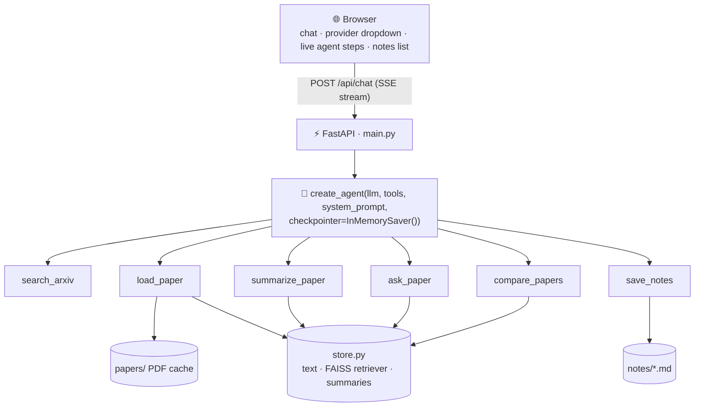
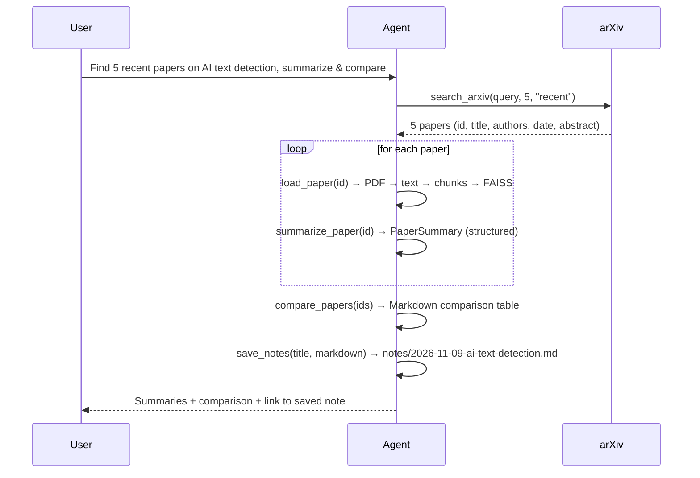

# 📚 Research Paper Agent: Project Plan

> An AI agent that **searches arXiv, reads papers, summarizes them, compares their methods and saves Markdown notes**, with a FastAPI backend and a web chat page.

**Example request:**
> *"Find 5 recent papers on AI-generated text detection, summarize them and compare their methods."*

This feeds directly into my [Humanizer project](../../Humanizer%20Project/), because the agent can build its literature review.

**Decisions made**
- Interface: **FastAPI backend + HTML/JS web page**
- LLM: **switchable**. Gemini 2.5 Flash is the default; Groq Llama 3.3-70B is the alternative.
- Location: `LangChain_Models/research_agent/`. It reuses the existing `.env` and `venv`.

---

## 1. Is my current knowledge enough?

**Mostly yes, about 80%.** Most of the building blocks already exist in this repo; the project adds 5 small new concepts.

### ✅ What I already know (and where)
| Needed for this project | Learned in |
|---|---|
| Chat models (Gemini, Groq), API keys in `.env` | [`ChatModels/`](../ChatModels/), [`find.py`](../find.py) |
| PromptTemplates, saving/loading templates | [`LangChain_promts/`](../LangChain_promts/), [`paper_summary_template.json`](../paper_summary_template.json) |
| Structured output with Pydantic | [`LangChain_structured_output/`](../LangChain_structured_output/) |
| PDF loading and text splitting | [`Document_loaders/pdf_loader.py`](../Document_loaders/pdf_loader.py), [`Text_splitters/`](../Text_splitters/) |
| Embeddings + FAISS + grounded RAG chain | [`yt_rag/rag_pipeline.py`](../yt_rag/rag_pipeline.py) (`build_retriever`, `format_docs`, `build_rag_chain`) |
| `@tool`, tool schemas, `create_agent` | [`Tools/`](../Tools/), [`Agents/agent.py`](../Agents/agent.py) |
| Web backend + JS frontend + per-user sessions | [`yt_rag/app.py`](../yt_rag/app.py) (Flask) |

### 🆕 What I will learn
| New concept | Size | Why it's needed |
|---|---|---|
| **arXiv API** (`arxiv` Python package) | Small (~1 hour) | Searching papers and getting PDF links |
| **FastAPI** | Easy: like Flask plus Pydantic, which I know | Routes, request models, `StreamingResponse`, `FileResponse`, auto `/docs` |
| **Agent memory** (`checkpointer` + `thread_id`) | One concept | Follow-up questions like *"now compare only papers 2 and 4"* |
| **Streaming agent steps (SSE)** | One concept | Showing "🔍 searching arXiv…" live in the browser |
| **Long documents vs. context limits** | Practical skill | Papers are long; Groq's context is smaller, so it needs truncation or map-reduce |

### 📦 Packages
Already in `LangChain_Models/venv`: langchain 1.4.4, langgraph, langchain-google-genai, langchain-groq, faiss-cpu, pypdf, ddgs, uvicorn.
**To install:** `arxiv`, `fastapi`.

---

## 2. Architecture



### Typical agent flow


---

## 3. Files

```text
research_agent/
├── plan.md                     ← this file
├── llm.py                      # get_llm(provider): Gemini or Groq
├── store.py                    # in-memory paper cache + papers/ folder
├── schemas.py                  # PaperSummary, PaperComparison (Pydantic)
├── prompts/
│   └── paper_summary_v2.json   # upgraded summary template (uses the real paper text)
├── tools.py                    # the 6 @tool functions
├── agent.py                    # build_agent(provider) + CLI for testing
├── main.py                     # FastAPI app
├── templates/index.html        # web page
├── static/app.js               # chat, SSE stream, Markdown rendering
├── static/style.css
├── papers/                     # downloaded PDFs (git-ignored)
├── notes/                      # saved Markdown notes
└── requirements.txt
```

### `llm.py`
- `get_llm(provider: "gemini" | "groq")`
  - `gemini` → `ChatGoogleGenerativeAI(model="gemini-2.5-flash", temperature=0)`
  - `groq` → `ChatGroq(model="llama-3.3-70b-versatile", temperature=0)`
- Embeddings always use Gemini `gemini-embedding-2`, the same as yt_rag.

### `store.py`
- `papers[arxiv_id] = {meta, text, chunks, retriever, summary}`
- PDFs are cached in `papers/` so a paper is never downloaded twice.

### `prompts/paper_summary_v2.json`
The current [`paper_summary_template.json`](../paper_summary_template.json) only passes the **paper title**, so the LLM summarizes from memory and may hallucinate. v2 passes the actual text:
- variables: `{paper_text}`, `{style}`, `{length}`
- keeps the existing rule: *"If information is not available, respond with 'Insufficient information available'"*

### `schemas.py`
```python
class PaperSummary(BaseModel):
    arxiv_id: str
    title: str
    problem: str
    method: str
    datasets: list[str]
    key_results: list[str]
    limitations: list[str]
    key_equations: list[str]
    one_line_takeaway: str

class PaperComparison(BaseModel):
    dimensions: list[str]          # e.g. Method, Dataset, Results, Limitations
    rows: list[dict[str, str]]     # one row per paper
    overall_insight: str
```

### `tools.py`: the 6 tools
Each tool returns **short strings** so the agent's context stays small. The large data stays in `store.py`.

| # | Tool | What it does |
|---|---|---|
| 1 | `search_arxiv(query, max_results=5, sort="relevance"\|"recent")` | Calls the `arxiv` package and returns id, title, authors, date and a short abstract. Respects arXiv's rate limit (~1 request every 3 seconds). |
| 2 | `load_paper(arxiv_id)` | Downloads the PDF, extracts the text with `PyPDFLoader`, chunks it with `RecursiveCharacterTextSplitter` and builds a FAISS retriever (same pattern as yt_rag `build_retriever`). Returns only the title and page count. |
| 3 | `summarize_paper(arxiv_id, style, length)` | Runs the v2 template with `with_structured_output(PaperSummary)`. Gemini gets the full text; Groq uses map-reduce over chunks. Caches the result. |
| 4 | `ask_paper(arxiv_id, question)` | Grounded RAG Q&A: same chain shape and "answer ONLY from context" prompt as yt_rag. |
| 5 | `compare_papers(arxiv_ids)` | Builds a Markdown comparison table from the cached summaries (`PaperComparison`). |
| 6 | `save_notes(title, markdown)` | Writes `notes/<date>-<slug>.md` and returns the path. |

### `agent.py`
- `build_agent(provider)` calls `create_agent(model, tools, system_prompt, checkpointer=InMemorySaver())`
- The system prompt defines the workflow: **search → load → summarize → compare → save**, always cite arXiv ids, and never invent paper content.
- `thread_id` gives each conversation its own memory.
- A CLI `__main__` lets the agent run without the UI: `python agent.py "your request"`

### `main.py` (FastAPI)
| Route | Purpose |
|---|---|
| `GET /` | Web page (Jinja2 template) |
| `POST /api/chat` | Body `{message, thread_id, provider}`. Returns a `StreamingResponse` (SSE) from `agent.stream(..., stream_mode="updates")` with events `tool_call`, `tool_result` (truncated) and `final` |
| `GET /api/notes` | List saved notes |
| `GET /api/notes/{name}` | Download a note (`FileResponse`) |
| `GET /api/papers` | List cached papers |

Errors (arXiv down, broken PDF, LLM rate limit) become friendly messages, the same idea as `RAGError` in yt_rag.

### Web page
- Chat panel + **provider dropdown** (Gemini / Groq)
- Live **"Agent steps"** panel: 🔍 searching arXiv… · 📄 reading 2401.xxxxx · 📝 summarizing… · 💾 saved note
- Answers rendered as Markdown (marked.js from cdnjs)
- Sidebar with saved notes and download buttons

---

## 4. Build order (each milestone works on its own)

| # | Milestone | Done when | What I learn |
|---|---|---|---|
| 0 | **Setup** | Folder created, `pip install arxiv fastapi`, `.env` loads | — |
| 1 | **Tools alone** | A test script calls each tool directly: finds papers, downloads one PDF, prints a valid `PaperSummary` | arXiv API, PDF caching, structured summaries from real text |
| 2 | **CLI agent** | `python agent.py "Find 5 recent papers on AI text detection…"` gives 5 summaries, a comparison table and a file in `notes/` | Workflow system prompts, multi-tool agents |
| 3 | **Memory + provider switch** | Follow-ups keep context; the same request also works with Groq | Checkpointers, `thread_id`, context limits, map-reduce |
| 4 | **FastAPI backend** | Endpoints work from the auto-generated `/docs` page | FastAPI, Pydantic request models, SSE streaming |
| 5 | **Web page** | Chat with live tool steps, rendered Markdown and notes download | Consuming SSE with JavaScript |
| 6 | **Polish** | Caching, friendly errors, and a saved "Humanizer literature review" note | Making the app reliable enough for daily use |

---

## 5. Verification
- **Milestone 1:** the tool test script finds papers, downloads a PDF and prints a valid `PaperSummary`.
- **Milestone 2:** the CLI request produces 5 summaries, a comparison table and a note file.
- **Milestones 4–5:** run the server, open the page and test the full flow.
  ```bash
  uvicorn main:app --reload
  ```
  Then open http://127.0.0.1:8000.
  - Run the full request with **Gemini**, then switch to **Groq** and ask a follow-up.
  - Check that the tool steps stream live, the Markdown renders and the note downloads.
- **Edge cases:** a query with no results, a paper with a broken PDF, and an LLM rate-limit error. Each should show a friendly message.

---

## 6. Future upgrades (after v1 works)
- Semantic Scholar API for citation counts and related papers
- Persistent memory (SQLite checkpointer) so conversations survive restarts
- "Upload your own PDF" in addition to arXiv
- Export the comparison as a `.docx` or a slide deck
- Rewrite as a **LangGraph** graph with explicit nodes (search → read → summarize → compare) and human approval before saving
