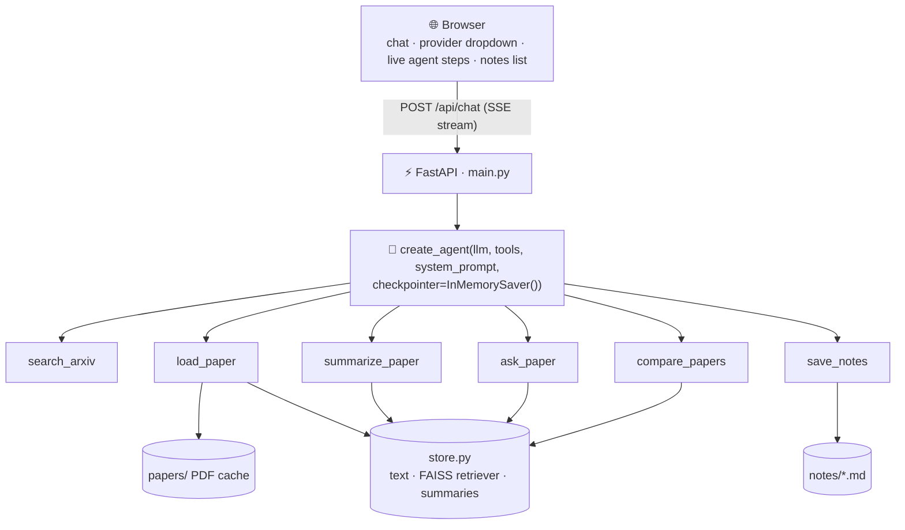
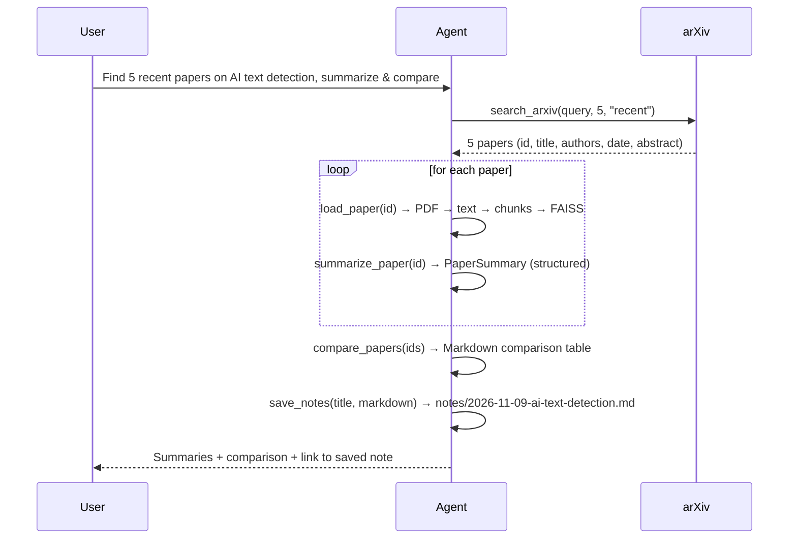

# 📚 Research Paper Agent: Project Plan

> An AI agent that **searches arXiv, reads papers, summarizes them, compares their methods and saves Markdown notes**, with a FastAPI backend and a web chat page.

**Example request:**
> *"Find 5 recent papers on AI-generated text detection, summarize them and compare their methods."*

This feeds directly into my [Humanizer project](../../Humanizer%20Project/), because the agent can build its literature review.

**Decisions made**
- Interface: **FastAPI backend + HTML/JS web page**
- LLM: **switchable**. Gemini 2.5 Flash is the default; Groq `openai/gpt-oss-120b` is the alternative (Llama 3.3-70B was retired by Groq). OpenRouter free models are a third option (`OPENROUTER_MODEL` in llm.py, default `nvidia/nemotron-3-ultra-550b-a55b:free`).
- Location: `LangChain_Models/research_agent/`. It reuses the existing `.env` and `venv`.

---

## 1. Is my current knowledge enough?

**Mostly yes, about 80%.** Most of the building blocks already exist in this repo; the project adds 5 small new concepts.

### ✅ What I already know (and where)
| Needed for this project | Learned in |
|---|---|
| Chat models (Gemini, Groq), API keys in `.env` | [`ChatModels/`](../ChatModels/), [`find.py`](../find.py) |
| PromptTemplates, saving/loading templates | [`LangChain_promts/`](../LangChain_promts/), [`paper_summary_template.json`](../paper_summary_template.json) |
| Structured output with Pydantic | [`LangChain_structured_output/`](../LangChain_structured_output/) |
| PDF loading and text splitting | [`Document_loaders/pdf_loader.py`](../Document_loaders/pdf_loader.py), [`Text_splitters/`](../Text_splitters/) |
| Embeddings + FAISS + grounded RAG chain | [`yt_rag/rag_pipeline.py`](../yt_rag/rag_pipeline.py) (`build_retriever`, `format_docs`, `build_rag_chain`) |
| `@tool`, tool schemas, `create_agent` | [`Tools/`](../Tools/), [`Agents/agent.py`](../Agents/agent.py) |
| Web backend + JS frontend + per-user sessions | [`yt_rag/app.py`](../yt_rag/app.py) (Flask) |

### 🆕 What I will learn
| New concept | Size | Why it's needed |
|---|---|---|
| **arXiv API** (`arxiv` Python package) | Small (~1 hour) | Searching papers and getting PDF links |
| **FastAPI** | Easy: like Flask plus Pydantic, which I know | Routes, request models, `StreamingResponse`, `FileResponse`, auto `/docs` |
| **Agent memory** (`checkpointer` + `thread_id`) | One concept | Follow-up questions like *"now compare only papers 2 and 4"* |
| **Streaming agent steps (SSE)** | One concept | Showing "🔍 searching arXiv…" live in the browser |
| **Long documents vs. context limits** | Practical skill | Papers are long; Groq's context is smaller, so it needs truncation or map-reduce |

### 📦 Packages
Already in `LangChain_Models/venv`: langchain 1.4.4, langgraph, langchain-google-genai, langchain-groq, faiss-cpu, pypdf, ddgs, uvicorn.
**To install:** `arxiv`, `fastapi`.

---

## 2. Architecture



### Typical agent flow


---

## 3. Files

```text
research_agent/
├── plan.md                     ← this file
├── llm.py                      # get_llm(provider): Gemini or Groq
├── store.py                    # in-memory paper cache + papers/ folder
├── schemas.py                  # PaperSummary, PaperComparison (Pydantic)
├── prompts/
│   └── paper_summary_v2.json   # upgraded summary template (uses the real paper text)
├── tools.py                    # the 6 @tool functions
├── agent.py                    # build_agent(provider) + CLI for testing
├── main.py                     # FastAPI app
├── templates/index.html        # web page
├── static/app.js               # chat, SSE stream, Markdown rendering
├── static/style.css
├── papers/                     # downloaded PDFs (git-ignored)
├── notes/                      # saved Markdown notes
└── requirements.txt
```

### `llm.py`
- `get_llm(provider: "gemini" | "groq")`
  - `gemini` → `ChatGoogleGenerativeAI(model="gemini-2.5-flash", temperature=0)`
  - `groq` → `ChatGroq(model="openai/gpt-oss-120b", temperature=0)`
- Embeddings always use Gemini `gemini-embedding-2`, the same as yt_rag.

### `store.py`
- `papers[arxiv_id] = {meta, text, chunks, retriever, summary}`
- PDFs are cached in `papers/` so a paper is never downloaded twice.

### `prompts/paper_summary_v2.json`
The current [`paper_summary_template.json`](../paper_summary_template.json) only passes the **paper title**, so the LLM summarizes from memory and may hallucinate. v2 passes the actual text:
- variables: `{paper_text}`, `{style}`, `{length}`
- keeps the existing rule: *"If information is not available, respond with 'Insufficient information available'"*

### `schemas.py`
```python
class PaperSummary(BaseModel):
    arxiv_id: str
    title: str
    problem: str
    method: str
    datasets: list[str]
    key_results: list[str]
    limitations: list[str]
    key_equations: list[str]
    one_line_takeaway: str

class PaperComparison(BaseModel):
    dimensions: list[str]          # e.g. Method, Dataset, Results, Limitations
    rows: list[dict[str, str]]     # one row per paper
    overall_insight: str
```

### `tools.py`: the 6 tools
Each tool returns **short strings** so the agent's context stays small. The large data stays in `store.py`.

| # | Tool | What it does |
|---|---|---|
| 1 | `search_arxiv(query, max_results=5, sort="relevance"\|"recent")` | Calls the `arxiv` package and returns id, title, authors, date and a short abstract. Respects arXiv's rate limit (~1 request every 3 seconds). |
| 2 | `load_paper(arxiv_id)` | Downloads the PDF, extracts the text with `PyPDFLoader`, chunks it with `RecursiveCharacterTextSplitter` and builds a FAISS retriever (same pattern as yt_rag `build_retriever`). Returns only the title and page count. |
| 3 | `summarize_paper(arxiv_id, style, length)` | Runs the v2 template with `with_structured_output(PaperSummary)`. Gemini and OpenRouter get the full text; Groq gets the first 12k + last 4k characters. Caches the result. |
| 4 | `ask_paper(arxiv_id, question)` | Grounded RAG Q&A: same chain shape and "answer ONLY from context" prompt as yt_rag. |
| 5 | `compare_papers(arxiv_ids)` | Builds a Markdown comparison table from the cached summaries (`PaperComparison`). |
| 6 | `save_notes(title, markdown)` | Writes `notes/<date>-<slug>.md` and returns the path. |

### `agent.py`
- `build_agent(provider)` calls `create_agent(model, tools, system_prompt, checkpointer=InMemorySaver())`
- The system prompt defines the workflow: **search → load → summarize → compare → save**, always cite arXiv ids, and never invent paper content.
- `thread_id` gives each conversation its own memory.
- A CLI `__main__` lets the agent run without the UI: `python agent.py "your request"`

### `main.py` (FastAPI)
| Route | Purpose |
|---|---|
| `GET /` | Web page (Jinja2 template) |
| `POST /api/chat` | Body `{message, thread_id, provider}`. Returns a `StreamingResponse` (SSE) from `agent.stream(..., stream_mode="updates")` with events `tool_call`, `tool_result` (truncated) and `final` |
| `GET /api/notes` | List saved notes |
| `GET /api/notes/{name}` | Download a note (`FileResponse`) |
| `GET /api/papers` | List cached papers |

Errors (arXiv down, broken PDF, LLM rate limit) become friendly messages, the same idea as `RAGError` in yt_rag.

### Web page
- Chat panel + **provider dropdown** (Gemini / Groq)
- Live **"Agent steps"** panel: 🔍 searching arXiv… · 📄 reading 2401.xxxxx · 📝 summarizing… · 💾 saved note
- Answers rendered as Markdown (marked.js from cdnjs)
- Sidebar with saved notes and download buttons

---

## 4. Build order (each milestone works on its own)

| # | Milestone | Done when | What I learn |
|---|---|---|---|
| 0 | **Setup** | Folder created, `pip install arxiv fastapi`, `.env` loads | — |
| 1 | **Tools alone** | A test script calls each tool directly: finds papers, downloads one PDF, prints a valid `PaperSummary` | arXiv API, PDF caching, structured summaries from real text |
| 2 | **CLI agent** | `python agent.py "Find 5 recent papers on AI text detection…"` gives 5 summaries, a comparison table and a file in `notes/` | Workflow system prompts, multi-tool agents |
| 3 | **Memory + provider switch** | Follow-ups keep context; the same request also works with Groq | Checkpointers, `thread_id`, context limits, map-reduce |
| 4 | **FastAPI backend** | Endpoints work from the auto-generated `/docs` page | FastAPI, Pydantic request models, SSE streaming |
| 5 | **Web page** | Chat with live tool steps, rendered Markdown and notes download | Consuming SSE with JavaScript |
| 6 | **Polish** | Caching, friendly errors, and a saved "Humanizer literature review" note | Making the app reliable enough for daily use |
| 6+ | **Upload your own PDF** | Upload a PDF in the sidebar and use every tool on it | File uploads with FastAPI (`UploadFile`) and `FormData` |

### Progress
| # | Status | Notes |
|---|---|---|
| 0–2 | ✅ Done | Tools tested; CLI agent in `agent.py` (`python agent.py groq` / `openrouter`) |
| 3 | ✅ Done | Memory works: "the second paper", "the first and third" resolve correctly across turns. Groq and OpenRouter run the full agent. Gemini's free tier is only **20 requests/day**, so it ran out before a full test. |
| 4 | ✅ Done | `main.py` FastAPI backend: `/api/chat`, `/api/chat/stream` (live events), `/api/papers`, `/api/notes`. Run with `python main.py`, test at http://127.0.0.1:8000/docs. All 3 providers share one memory, so you can switch provider in the middle of a conversation. |
| 5 | ✅ Done | Web page: `templates/index.html`, `static/css/style.css`, `static/js/app.js`. Chat with live agent steps, provider dropdown, New chat button, Markdown answers (tables) via marked.js, saved notes (download) and papers in the sidebar. Open http://127.0.0.1:8000 after `python main.py`. |
| 6 | ✅ Done | **Upload:** sidebar upload card → `POST /api/upload` → `uploads/upload-<name>.pdf`; ids start with `upload-` and work with every tool; new `list_uploaded_papers` tool. **Caching:** summaries and meta in `cache/<id>.json`, FAISS index in `cache/<id>_index/` (second question 80 s → 13 s, survives restarts). **Errors:** friendly messages for wrong/missing ids, broken or non-PDF files, network errors, daily quota, and bad tool calls. **Note:** `notes/2026-11-23-humanizer-literature-review.md` (3 arXiv papers + an uploaded paper). Added `README.md`. |
| 7 | ✅ Done | **Chat history:** `SqliteSaver` → `chat_history.db`; sidebar "💬 Chat history" lists chats (newest first), click to reopen and continue; survives restarts. **Click a paper:** sidebar paper → paper card + "Asking about" chip, questions sent with `paper_id`. **File names:** `papers/[arXiv id]-[year]-[title].pdf` (old files renamed on start or on first load). **Delete:** 🗑 per paper with a confirm box, removes PDF + cache + index. |
| 8 | ✅ Done | **New UI** from the Claude Design canvas: warm cream background, frosted-glass header and cards, Papers in a right column, custom provider dropdown, drop-zone upload, animated Agent steps card, typing animation and animated Send button, line icons (SVG sprite in `index.html`). **Download folder** card: `GET /api/settings`, `POST /api/settings/download-folder`, `POST /api/settings/open-folder`, saved in `settings.json`. |

**Milestone 6 findings**
- **Gemini comparison bug:** with 4 papers, Gemini's default structured output (`json_schema`) got stuck writing newlines for ~4 minutes and failed every time. `compare_papers` now uses `method="function_calling"` (18 s, works on all 3 providers), caps the output at 8000 tokens, and falls back to a simple table built from the saved summaries if the model still fails.
- **Free models sometimes call a tool with a wrong name** (Groq once called `summary_paper`). The page now says to type "continue".

**Milestone 3 findings**
- **Groq summaries are weaker:** Groq gets only the first 12k + last 4k characters, so it misses datasets and limitations that sit in the middle of a paper. Use OpenRouter (1M context) or Gemini for best summaries.
- **Gemini embeddings limit is 30,000 tokens/minute** (one paper ≈ 25k tokens), so embedding now runs in batches of 30 chunks with a 62 s wait between them, and `ask_paper` retries once on a rate limit or network error.
- **Retrieval limit:** answers hidden in tables (e.g. "z-threshold 4.0") can be missed, even with `k=6`. A future fix is the MultiQuery / MMR retrievers from `Retrivers/`.

---

## 5. Verification
- **Milestone 1:** the tool test script finds papers, downloads a PDF and prints a valid `PaperSummary`.
- **Milestone 2:** the CLI request produces 5 summaries, a comparison table and a note file.
- **Milestones 4–5:** run the server, open the page and test the full flow.
  ```bash
  uvicorn main:app --reload
  ```
  Then open http://127.0.0.1:8000.
  - Run the full request with **Gemini**, then switch to **Groq** and ask a follow-up.
  - Check that the tool steps stream live, the Markdown renders and the note downloads.
- **Edge cases:** a query with no results, a paper with a broken PDF, and an LLM rate-limit error. Each should show a friendly message.

---

## 6. Future upgrades (after v1 works)
- Semantic Scholar API for citation counts and related papers
- ~~Persistent memory (SQLite checkpointer) so conversations survive restarts~~ ✅ done in milestone 7
- ~~"Upload your own PDF" in addition to arXiv~~ ✅ done in milestone 6
- Export the comparison as a `.docx` or a slide deck
- Rewrite as a **LangGraph** graph with explicit nodes (search → read → summarize → compare) and human approval before saving

---

## 7. Milestone 7 plan: chat history, click-to-chat papers, file names, delete (✅ done)

### 7.1 Chat history saved in SQLite (same pattern as `D:\LangGraph\Chatbot\langGraph_database_backend.py`)
**Idea:** swap the memory. Today `main.py` keeps chats in `InMemorySaver`, so they are lost on restart. LangGraph's `SqliteSaver` saves every checkpoint into a file, `chat_history.db`, grouped by `thread_id`. The agent code itself does not change.

**`main.py`, Step 1**
```python
DB_PATH = store.BASE_DIR / "chat_history.db"

conn = sqlite3.connect(database=str(DB_PATH), check_same_thread=False)
memory = SqliteSaver(conn=conn)
```
**`main.py`, Step 3: new helpers** (same names as in your LangGraph chatbot)
- `retrive_all_thread_ids()` loops over `memory.list(None)` and collects the thread ids, newest first.
- `load_conversation(thread_id)` returns `agent.get_state(config).values.get("messages", [])`.
- `make_chat_history(messages)` turns LangChain messages into `{"role": "user"/"assistant", "content": ...}`. It skips tool messages and empty "tool call" messages, so only your questions and the agent's answers are shown.
- `get_thread_title(messages)` uses the first 50 characters of your first message as the chat's title.

**`main.py`, Step 4: new routes**
- `GET /api/threads` returns `[{thread_id, title}]` for the sidebar.
- `GET /api/threads/{thread_id}` returns the chat's messages, so the page can show them again.

**Web page:** a new sidebar card, **"💬 Chat history"**. Clicking a chat loads its messages and continues it (the same `threadId`). The current chat is highlighted. The list refreshes after every answer. **New chat** works as before.

**Install:** `pip install langgraph-checkpoint-sqlite`. This also updates `langgraph-checkpoint` from 4.1.1 to 4.3.2. `chat_history.db` is added to `.gitignore`.

### 7.2 Click a paper in the sidebar to chat about it
1. Each paper in the **📄 Papers** card becomes clickable.
2. Clicking it shows a **paper card** in the chat (title, id, year, authors) and a chip above the input: **"📄 Asking about: 2605.10977 ✕"**.
3. While the chip is on, every message you send includes `paper_id`. `main.py` adds one line in front of your message: `[Selected paper: 2605.10977 - PASA: ...]`. The agent then uses `ask_paper` / `summarize_paper` on that paper.
4. Click **✕**, start a **New chat**, or click another paper to change or clear it.
- `ChatRequest` gets an optional `paper_id: str | None = None`. `check_chat_request` adds the line.

### 7.3 Downloaded PDFs named `[Paper no]-[Publishing Year]-[Paper Title].pdf`
Example: `papers/2605.10977-2026-PASA A Principled Embedding-Space Watermarking Approach for LLM-Generated Text.pdf`
- **Paper no = the arXiv id** (unique, and the app needs it to find the file again). **Year** comes from `published`.
- **Title:** characters Windows does not allow (`\ / : * ? " < > |`) are removed, and the title is cut at 80 characters.
- `store.py`: new `make_pdf_name(meta)`, plus `find_pdf(paper_id)`, which finds a paper's file by its id prefix (`2605.10977-*.pdf`, or an old-style `2605.10977.pdf`).
- `tools.py`, `load_paper_text`: new downloads use the new name. An old-style file is renamed the first time it is loaded. On server start, old files whose info is already in `cache/` are renamed at once.
- **Uploaded papers keep their own file name** (`upload-<name>.pdf`). You named them, and they have no reliable year.

### 7.4 Delete a paper (with confirmation)
- Each paper in the sidebar gets a **🗑** button.
- Clicking it first asks: *"Delete 2605.10977 'PASA: ...'? This removes the PDF, its summary and its saved index. This cannot be undone."* (`confirm()` in the browser). **Cancel** does nothing.
- **OK** calls `DELETE /api/papers/{paper_id}`, which:
  - deletes the PDF (`papers/` or `uploads/`), `cache/<id>.json` and `cache/<id>_index/`;
  - removes the paper from memory;
  - refreshes the sidebar.
  - If that paper was the selected chip, the chip is cleared.
- `store.py` gets `delete_paper(paper_id)`. Saved notes are **not** deleted.

### 7.5 Files that will change
| File | Change |
|---|---|
| `main.py` | `SqliteSaver` memory, thread helpers, `/api/threads` routes, `DELETE /api/papers/{id}`, `paper_id` in `ChatRequest` |
| `store.py` | `make_pdf_name`, `find_pdf`, `rename_old_pdfs`, `delete_paper` |
| `tools.py` | Use the new file name when downloading or loading |
| `templates/index.html` | "💬 Chat history" card, selected-paper chip above the input |
| `static/css/style.css` | Styles for the history list, clickable papers, 🗑 button and chip |
| `static/js/app.js` | New sections: chat history, select a paper, delete a paper |
| `requirements.txt`, `.gitignore`, `README.md`, `plan.md` | Docs, the new package, ignore `chat_history.db` |

`agent.py` (the command-line chat) stays as it is, with in-memory chats.

### 7.6 How it will be tested
- Chat, **restart the server**, and check that the chat is still in "Chat history" and continues with memory.
- Switch between 2 chats, and check that each shows its own messages.
- Click a paper, ask "what dataset is used?", and check that the agent answers about that paper.
- Download a new paper and check the file name. Check that the old files were renamed and still load.
- Delete: **Cancel** keeps the paper. **OK** removes the file, cache and sidebar entry.
